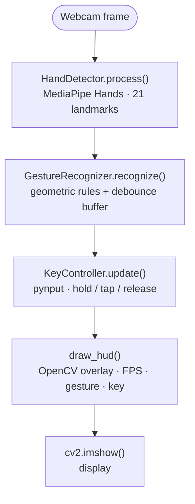

# 🎮 GesturePilot AI

<div align="center">

**Control games with your bare hands — no controller needed.**

[](https://python.org)
[](https://opencv.org)
[](https://mediapipe.dev)
[](LICENSE)

</div>

---

## 📖 Project Overview

**GesturePilot AI** is a real-time hand gesture recognition system that lets you play keyboard-controlled games (like **Hill Climb Racing**) using nothing but your webcam and your hands.

Powered by **Google MediaPipe**, it detects 21 hand landmarks per frame at 30+ FPS and maps natural hand gestures to game controls — no wearables, no extra hardware, no latency headaches.

---

## ✨ Features

| Feature | Description |
|---|---|
| 🖐 Real-time Detection | 21-landmark hand tracking via MediaPipe at 30+ FPS |
| 🎯 3 Gesture Controls | Open Palm, Fist, Peace |
| ⌨️ Keyboard Injection | pynput holds/taps keys exactly as a real keyboard would |
| 🧠 Gesture Smoothing | Debounce buffer prevents jitter and accidental keypresses |
| 📊 Live HUD | FPS, confidence %, gesture label, active key — all on screen |
| 🌙 Dark Futuristic UI | Glassmorphism-style overlay with neon cyan/green palette |
| 🎚 Adjustable Sensitivity | Press `+`/`-` to tweak gesture responsiveness live |
| 🔧 Calibration Mode | Toggle with `C` key at runtime |
| 🎮 Game-Agnostic | Change `KEY_MAP` in `config.py` for any keyboard game |

---

## 🕹️ Gesture Map

| Gesture | Symbol | Key Sent | Game Action |
|---|:---:|:---:|---|
| Open Palm | ✋ | `→` Right Arrow (held) | **Accelerate** |
| Closed Fist | ✊ | `←` Left Arrow (held) | **Brake / Reverse** |
| Peace / Victory | ✌️ | `P` (tap) | **Pause** |

---

## 🛠 Tech Stack

- **Python 3.10+** — core language
- **OpenCV 4.8+** — webcam capture, frame rendering, HUD drawing
- **MediaPipe 0.10+** — hand landmark detection (21 points, 30+ FPS)
- **NumPy** — array operations for geometry
- **pynput** — OS-level keyboard control (holds keys, not just taps)

---

## 🚀 Installation

### 1. Clone the repository
```bash
git clone https://github.com/thiteswapnil1212-hue/Hill-climb-racing-controller.git
cd Hill-climb-racing-controller
```

### 2. Create a virtual environment (recommended)
```bash
python -m venv venv
# Windows
venv\Scripts\activate
# macOS / Linux
source venv/bin/activate
```

### 3. Install dependencies
```bash
pip install -r requirements.txt
```

### 4. Run GesturePilot AI
```bash
python app.py
```

> **Tip:** Keep the GesturePilot AI window in the foreground while your game runs in the background. The keyboard events are injected globally.

---

## ⚙️ Configuration

All settings live in **`config.py`** — no need to touch any other file:

```python
# Change webcam
CAMERA_INDEX = 0          # 0 = default, 1 = external, etc.

# Tune detection sensitivity
DETECTION_CONFIDENCE = 0.75
TRACKING_CONFIDENCE  = 0.75

# Map gestures to any keys for any game
KEY_MAP = {
    "OPEN_PALM"  : "right",   # Accelerate (held)
    "FIST"       : "left",    # Brake / Reverse (held)
    "PEACE"      : "p",       # Pause (tap)
    "UNKNOWN"    : None,      # No key
}

# Gesture smoothing: 1 = most responsive, 10 = strictest
GESTURE_SENSITIVITY = 5
```

### Supporting a New Game

Just update `KEY_MAP`. Example for **Need for Speed (web)**:
```python
KEY_MAP = {
    "OPEN_PALM"  : "up",
    "FIST"       : "down",
    "PEACE"      : "space",   # handbrake
}
```

---

## 🏗 Architecture

```
GesturePilot-AI/
├── app.py          ← Main loop: capture → detect → recognize → control → render
├── detector.py     ← HandDetector (MediaPipe wrapper) + HandResult data class
├── gestures.py     ← GestureRecognizer: geometric rules + debounce smoothing
├── controller.py   ← KeyController: pynput keyboard state machine
├── config.py       ← All tunable constants (key map, camera, sensitivity, colors)
├── requirements.txt
└── README.md
```

### Data Flow



---

## ⌨️ Runtime Hotkeys

| Key | Action |
|---|---|
| `Q` | Quit GesturePilot AI |
| `C` | Toggle calibration mode |
| `+` | Increase gesture sensitivity |
| `-` | Decrease gesture sensitivity |

---

## 🔬 How It Works

1. **Capture** — OpenCV reads frames from your webcam at native resolution.
2. **Detect** — MediaPipe Hands locates 21 skeletal keypoints on your hand in each frame.
3. **Classify** — Geometric rules (finger extension, thumb direction, landmark distances) map landmark positions to one of three gestures.
4. **Smooth** — A debounce buffer requires a gesture to appear in N consecutive frames before it is confirmed, eliminating jitter.
5. **Control** — pynput holds or taps the appropriate OS key. Held keys (arrows) stay pressed while the gesture is maintained; tap key (P) fires once per gesture change.
6. **Display** — A semi-transparent HUD panel renders FPS, confidence, current gesture, and active key.

---

## 📈 Performance Notes

- Targets **30+ FPS** on modern hardware (tested on Intel Core i5 + integrated GPU).
- Processing is single-threaded. For higher FPS, consider offloading MediaPipe to a background thread.
- Reduce `FRAME_WIDTH` / `FRAME_HEIGHT` in `config.py` if you need more headroom.
- Ensure good lighting — MediaPipe performs best with even illumination.

---

## 🔮 Future Improvements

- [ ] Two-hand support (separate left/right hand gestures)
- [ ] Background threading for MediaPipe (decouple from render loop)
- [ ] Custom gesture training with custom landmarks
- [ ] GUI settings panel (tkinter or PyQt6)
- [ ] Game profiles (save / load key maps per game)
- [ ] Gesture history chart on HUD
- [ ] Mouse control mode (cursor follows palm position)
- [ ] Voice + gesture hybrid commands
- [ ] WebSocket mode (control a browser game from a remote machine)

---

## 🖼 Screenshots

> *Add screenshots here after running the project.*

| HUD Overview | Thumb Up Gesture | Fist Gesture |
|:---:|:---:|:---:|
| *(screenshot)* | *(screenshot)* | *(screenshot)* |

---

## 🎬 Demo Video

- [Screen recording — 11 Jul 2026](Screen%20Recording%202026-07-11%20223204.mp4)
- [Screen recording — 12 Jul 2026](Screen%20Recording%202026-07-12%20121530.mp4)

---

## 📄 License

This project is licensed under the **MIT License** — see [LICENSE](LICENSE) for details.

---

## 🙋 Author

Built with ❤️ using Python, OpenCV, and MediaPipe.  
*Showcasing the power of computer vision for accessible, controller-free gaming.*

---

<div align="center">
<strong>⭐ Star this repo if you found it useful!</strong>
</div>
